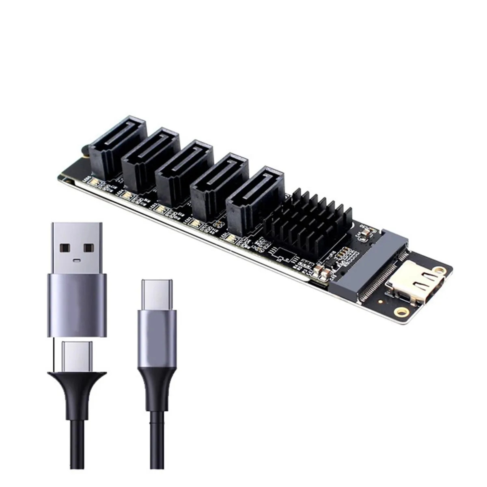

# JMicron JMS580 / JMB575 (PH8057) Firmware — Reverse Engineering & SMART Fix


> [!CAUTION]
> **AI-GENERATED PROJECT — USE AT YOUR OWN RISK.** All original research, analyses, documentation, tools, tests, and firmware patches in this project were written with generative AI (ChatGPT) under the device owner's direction. Third-party source code and proprietary vendor firmware remain the work of their respective authors. AI-generated results may contain errors, and the project has **not** received independent professional safety or reliability certification.
>
> **YOU ARE RESPONSIBLE FOR YOUR DEVICE AND DATA.** Any use, modification, or flashing of firmware is entirely at your own risk. You are responsible for compatibility, backups, recovery planning, hardware damage, data corruption, and data loss. This project is provided **AS IS, WITHOUT WARRANTY**. A successful test on one PH8057 does not establish safety for another device.
>
> **COPYRIGHT — NO VENDOR BINARIES OR WINDOWS FLASHER.** Complete original and modified firmware BIN files and proprietary Windows flashing software are **not distributed in this repository** because permission to redistribute these third-party copyrighted materials has not been established. The repository provides patch sources, reproducible builders, manifests, and references instead.

### A word from the carbon-based owner 🥩

> The carbon-based lifeform behind this project has absolutely no idea what half of these registers are doing. He just wanted proper SMART data and a sensible HDD standby setup. He got what he came for. The AI can argue with the silicon about the rest. 😄
>
> And yes, this paragraph was also written by AI. The human was too lazy to write even his own disclaimer. 🤖



*Product photo supplied by the project owner, originally shown in an Ozon listing. The image is now stored in this repository; see [image attribution](NOTICE.md#image-attribution).*

This project consolidates the supplied PH8057 research into reproducible offline analysis, a corrected OEM decoder, a strict 8051 executor, regression tests, and guarded firmware patch builders. PH8057 is the four-drive enclosure examined in the supplied evidence: a **JMicron JMS580 USB-to-SATA bridge** communicates with a **JMB575 SATA port multiplier**. This repository applies to the exact captured firmware identified below; it is not a general JMS580 firmware distribution.

**The independent audit produced a revised CK_COND candidate and corrected analysis/test defects. It did not establish a safe UDMA residue repair.** The UDMA candidate is an observation trampoline that deliberately retains the known accounting defect. The original audit was entirely offline. Subsequently, on **2026-11-02**, the enclosure owner installed the SMART-only revised firmware in a PH8057 and reported successful read-only SMART STATUS and CHECK POWER MODE tests on one physical HDD. This is **limited hardware evidence, not full qualification**; other commands, LUNs, interruption handling and data integrity remain unverified. See [post-flash verification](docs/postflash-hardware-check-2026-11-02.md).

## Results and status

| Area | Result | Qualification |
|---|---|---|
| Factory provenance and layout | Exact full capture, original v8, nine donor containers, nested historical evidence inventoried and hashed | **CONFIRMED** for supplied files; acquisition histories outside the archives remain unverified |
| Factory UDMA Data-Out defect | The supplied WRITE DMA EXT transaction reports GOOD and residue=512 after 512 successful USB Data-Out bytes; native instructions reproduce the supplied CSW | **HARDWARE VALIDATED** observation supplied by the owner, plus **OFFLINE VALIDATED** reproduction; no new physical test |
| OEM analysis | Corrected 512-byte atlas, 32 flag records, stateful models, native retry/USB-field regressions and serial redaction | **OFFLINE VALIDATED**; private hardware register semantics remain **UNKNOWN** |
| Original CK_COND v8 | Reconstructed exactly; original suite passes; additional native abort path exposes a stale-snapshot defect | **EXPERIMENTAL**, superseded for further research by revised candidate |
| Revised CK_COND | Clears unpublished ATA capture validity at both native USB-wait abort exits; SMART STATUS and CHECK POWER MODE now return ATA descriptors on one HDD | **LIMITED HARDWARE VALIDATED** for two owner-supplied commands; remainder **EXPERIMENTAL / UNQUALIFIED** |
| UDMA residue correction | Root cause localized; a trustworthy per-command processed-byte quantity is missing | **NOT IMPLEMENTED**; release blocked by hardware evidence |
| UDMA observation candidate | Adds entry/exit observation PCs without an assumed counter, persistent RAM allocation or changed residue/status | **OFFLINE VALIDATED / EXPERIMENTAL**; not a residue fix or autonomous logger |
| Revised CK + UDMA observation | Combined image built once from stock; native state and bus-event comparisons verify the bounded interaction | **OFFLINE VALIDATED / EXPERIMENTAL**; no combined SMART+UDMA **fix** is claimed |
| Ordinary SCSI READ/WRITE | Admission and shared state/sense behavior compared across candidates | **OFFLINE VALIDATED** for these paths; complete payload transfer and media integrity unqualified |
| UASP | OEM descriptor gate alone is insufficient; foreign JMS567 patch was not ported | **NOT IMPLEMENTED** |
| Hot-swap | Port/LUN compaction and event paths documented; disconnect cause unresolved | **NOT IMPLEMENTED** |

The status words have precise scope. **CONFIRMED** identifies an artifact or directly established fact. **OFFLINE VALIDATED** means specified code executed under declared fixtures. **HARDWARE VALIDATED** is reserved for actual owner-supplied device observations, now including the limited post-audit SMART results on revised CK_COND firmware; it does not imply whole-image qualification. **EXPERIMENTAL** does not imply safe installation. **NOT IMPLEMENTED** and **UNKNOWN** are explicit boundaries, not successful tests.

## What changed

The revised CK_COND firmware fixes a defect in v8 itself. v8 captured a successful ATA result before `AEF4 → CBE3` completed the USB Data-Out wait. On either native inactive/abort exit, that snapshot could remain valid and later be published as informational CK_COND sense if the scheduled finalizer ran. The new `CBF6`/`CC04` hooks preserve the normal retry paths and clear only the existing unpublished-valid byte `XDATA 4E07` on carry-set exits. Registers and native error policy are preserved. See [the CK_COND analysis](docs/smart-ckcond-fix.md).

The UDMA investigation rejects the earlier `70C0..70C3 ==0` residue-clearing prototype. Native instructions provide a stronger arithmetic/compare interpretation of this interface than a universal DMA counter. A new counterexample also proves that the old helper can clear residue after the native wait aborts. The current project exposes that rejected implementation only as an in-memory negative regression. It has no release builder. See [UDMA accounting](docs/udma-csw-residue.md).

OEM corrections include the actual twelve-copy F8.7 failure path and sticky mismatch latch, the reversed historical wValue/wIndex fixture, state preservation concealed by clean-RAM tests, real callee clobbers concealed by return stubs, and serial disclosure through byte tables. The already-correct v29 E7.7 distinction is explicitly credited and retained. Unknown fields and optional hardware behavior remain unassigned; factory OEM settings are unchanged. See [the OEM reference](docs/oem-reference.md) and [machine-readable atlas](research/oem/oem_512_bytes.csv).

The tools now reject ambiguous 64 KiB inputs, invalid fixture ranges, deterministic continuation after undefined DIV-by-zero results, assertion-disabled test execution, unsafe patch prerequisites and source/output aliasing. MMIO traces identify the actual executed instruction PC. Conditional branches read only their required modeled SFR condition. Historical replay validates the reviewed source hashes before execution. These corrections are covered by regressions, including failures reproduced against earlier implementations.

## Reproduce the public offline checks

Requirements: Python 3.11 or 3.12, standard library, and a C compiler (`cc` or `gcc`) for the independent decoder comparison. No Python packages, USB libraries, network access or vendor firmware downloads are needed for the public test run.

```bash
python3 run_tests.py --out build/public-validation
```

This runs portable tests and explicitly records private-firmware skips. A green public CI result does **not** mean the real firmware-dependent paths were executed. The GitHub Actions workflow runs the same safe entry point on both Python versions. It does not contain firmware secrets or hardware operations.

For the native firmware suites, supply your local complete factory capture:

```bash
python3 ph8057.py inspect /absolute/path/complete-factory.bin
python3 run_tests.py --stock /absolute/path/complete-factory.bin --out build/full-validation
python3 ph8057.py oem --stock /absolute/path/complete-factory.bin --out build/oem
```

Only this full factory input is accepted for exact-address patching:

```text
Length: 70144 bytes (0x11200)
SHA256: ef5ad9af3f3b290c565a4dc65933d539b7bb8b8051ac9bd45386932a77862c09
```

The older `ph8057-original.bin` is the first 65536 bytes of that SPI image, not the CPU CODE image. The proper CODE slice is file `0x1000..0x10FFF`. The nine donor update containers instead place CODE at `0x400..0x103FF`. Confusing these layouts changes every inferred CPU address.

### Build the experimental variants

```bash
python3 ph8057.py build ckcond-v8 --stock /absolute/path/complete-factory.bin --out build/candidates
python3 ph8057.py build ckcond-revised --stock /absolute/path/complete-factory.bin --out build/candidates
python3 ph8057.py build udma-trace --stock /absolute/path/complete-factory.bin --out build/candidates
python3 ph8057.py build combined-revised-trace --stock /absolute/path/complete-factory.bin --out build/candidates
```

`ckcond-v8` recreates the original artifact exactly. `ckcond-revised` adds the verified abort invalidation. `udma-trace` preserves factory accounting. `combined-revised-trace` composes revised CK_COND with that observation helper. There is intentionally no `udma-fix` option.

The builder validates the source SHA256, all expected bytes, code-cave contents, patch overlap, CODE/trailer boundaries, OEM preservation and four CRC relationships. It records exact CPU/file offsets, before/after bytes and SHA256 in JSON. Valid checksums demonstrate container consistency; they do not prove correct loader behavior, free SRAM, interrupt safety or recoverability.

Firmware binaries are omitted from this public package because redistribution rights are not established. [Firmware manifests](firmware/manifests/) identify reproducible outputs. The separately supplied private research archive contains original evidence and experimental BINs. For the 67,072-byte updater-style package derived from the owner's exact `1.bin`, see [device-specific source-only folder](firmware/ph8057-device/README.md).

### Replay the historical research

The original v2–v29 material is retained in the private research archive. Versions describe research stages; they are not 29 distinct firmware releases. The archives contain three obsolete 65536-byte lab IMG files, but no complete v2–v6 flash-image chain. There is no separate v9 offline test suite; v9/v9.1 collectors and captures are present. The original v3 restricted-wrapper source is missing and its binary-backed reconstruction is identified separately. The exact available artifacts are indexed in [historical provenance](research/historical/README.md).

To reconstruct the content-addressed evidence tree from the two original attachments:

```bash
python3 tools/history/extract_history.py /path/first-attachment.zip /path/second-attachment.zip --out /private/audit_input
python3 run_tests.py --stock /absolute/path/complete-factory.bin --history-root /private/audit_input --out build/history-validation
```

Historical wrappers copy the reviewed inputs to temporary directories, retain expected values, substitute the corrected emulator where documented, and run only the reviewed offline entry points. A source mismatch is a failure. The v20 hardcoded path is adapted explicitly. Hardware collectors remain historical evidence and are not current operational tools.

## Evidence quality

The famous **33,816** is a total of heterogeneous, overlapping historical check units. Instrumentation counted **44,211** executed assertion/check guards. Most suites execute original 8051 instructions, but memory and peripheral states are fixtures; some copy/peripheral callees are stubbed, and 241 units are static/bookkeeping checks. Neither total is a coverage percentage or a number of independent physical tests.

New evidence includes 19,790 native OEM checks; 128 abort-leaf ABI cases; 112 paired native SAT dispatch scenarios; ordinary-SCSI state comparisons; and 24 UDMA scenario definitions across three bases with and without observation instrumentation, yielding 72 pairs. These remain separate categories. See [validation methodology](docs/validation.md), [the audit and fix report](docs/independent-audit-and-fix-report.md), and [firmware comparison](docs/firmware-validation-report.md).

The archived SG_IO report, the later user-supplied USB CBW/CSW excerpt, and the new emulated CSW are distinct evidence. A complete original usbmon capture was not supplied. The test framework does not relabel generated traces as real captures.

## Hardware limits and next evidence

Before any modified firmware can be qualified, the project needs independently established SRAM ownership for `4D00..4DFF`/`4E00..4E1F`, command-coherent `6300` snapshots, stack/interrupt headroom, code-cave execution and recovery. A real UDMA fix additionally needs a stable count or event contract for bytes **processed**, including partial, error and recovery cases. The [manual qualification plan](tests/hardware/QUALIFICATION_PLAN.md) specifies observations and acceptance criteria without runnable disk-write or SPI commands.

UASP and hot-swap are excluded from this implementation. The external `9500/ds500u3-jms567-uas` project targets JMS567 and has useful experiments, but it neither proves JMS580 compatibility nor licenses vendor firmware. The JMB575 product brief advertises hardware capabilities that this board firmware has not qualified. See [limitations](docs/limitations.md), [architecture](docs/architecture.md), [references](docs/references.md), and [NOTICE](NOTICE.md).

## Owner-device update package and Windows updater

The owner read back a 67,072-byte JMicron update-container `1.bin`, then installed a modified package generated from it with revised CK_COND instructions and recalculated CRC fields. The public repository contains **the source-only reproducible builder, patch records and hashes, not either binary**. See [original](firmware/ph8057-device/original/README.md) and [modified](firmware/ph8057-device/modified/README.md). The owner also requested a [Windows flasher staging folder](software/windows-flasher/README.md); third-party executables have not been included because their redistribution permission has not been established.

## Repository map

| Location | Purpose |
|---|---|
| `ph8057.py`, `run_tests.py` | Unified build/analysis and offline regression entry points |
| `tools/emulator/` | One corrected ISA executor, dual-DPTR fixture and independent MIT decoder oracle |
| `tools/analysis/` | Canonical OEM and explicit container inspection |
| `tools/patching/ckcond/`, `tools/patching/udma/` | Guarded source builders and their tests |
| `tools/history/` | Bounded extraction and hash-verified historical replay |
| `research/oem/`, `research/findings/`, `research/validation/` | Redacted tables, issue registry and evidence summaries |
| `tests/integration/`, `tests/hardware/` | Composition regressions and manual hardware qualification plan |
| `firmware/manifests/`, `firmware/ph8057-device/` | Hashes, offsets, reproducible updater-format builder, separate original/modified placeholders; no vendor BINs |
| `software/windows-flasher/` | Staging instructions for third-party Windows flashing software; no EXE supplied |
| `docs/` | Engineering reports and the twelve direct final-status answers |

Project-authored code and documentation use the scoped MIT license in [LICENSE](LICENSE). Third-party notices and exclusions are in [NOTICE](NOTICE.md). No rights in vendor firmware or private identifiers are asserted.
